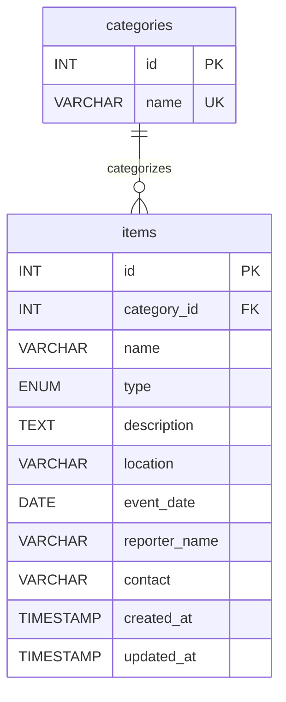

# University Lost and Found Portal

Small PHP application for the EC4307 30-mark mini-project rubric. Item reports support persistent Create, Read (including details/search/filter/sort), Update and confirmed Delete operations.

## Requirements and setup

- Existing XAMPP with Apache, PHP 8.1+ (PDO MySQL and mbstring), and MySQL/MariaDB.
- Keep this folder in `C:\xampp\htdocs\university-lost-and-found-portal`.
- Start Apache and MySQL using the XAMPP control panel.
- Import `database/schema.sql` with phpMyAdmin's Import tab or the MySQL client. It creates `university_lost_found`, its tables and six categories. Reimporting does not erase records.
- Open <http://localhost/university-lost-and-found-portal/>.
- `config/database.php` uses the local XAMPP defaults (127.0.0.1:3306, root, empty password). Environment variables `DB_HOST`, `DB_PORT`, `DB_NAME`, `DB_USER`, `DB_PASSWORD` override them. Configure these in the Apache environment and restart Apache if needed. Use a dedicated database account for deployment; never commit credentials.

The application does not automatically load `.env` or `config/local.php`. Supply overrides through the PHP/Apache process environment; keep the tracked `config/database.php` free of private credentials. The SQL import requires permission to create the database and tables.

Apache must honor the project's `.htaccess` files. In the directory configuration covering this project, `AllowOverride` must permit the `AuthConfig` and `Options` directive groups used by `Require all denied` and `Options -Indexes`. If overrides are disabled, the access protections will not apply. With Apache running, verify that requests to `config/database.php`, `includes/bootstrap.php`, `database/schema.sql`, and `tests/integration.php` return HTTP 403. Do not remove the access rules to resolve a setup error.

The supplied university logo (`assets/images/ruhuna-logo.png.png`) and assignment rubric PDF (`docs/Mini Project Evaluation Rubric - COM.pdf`) are retained locally but excluded from Git because redistribution permission has not been established. A fresh clone will not include them: obtain an authorized logo separately and place it at the documented path to reproduce the local header. The application references that local logo; no replacement asset is downloaded automatically. Obtain the rubric through the course's authorized channel. The schema remains included for evaluators.

This is a shared local assessment application. No user accounts or ownership roles were specified: all visitors can edit/delete all reports, and reporter contact details are visible. Keep it local; public deployment requires an approved access policy and authentication/authorization implementation. No security settings are disabled by setup.

## Structure

- `index.php`: browse/search/filter/sort.
- `item.php`: report details.
- `item-form.php`: create/edit with shared validation.
- `delete.php`: confirmation and POST-only deletion.
- `includes/`: PDO connection, validation, session/CSRF, escaping and shared templates.
- `config/`: environment-based connection settings.
- `assets/`: responsive CSS and progressive JavaScript validation/confirmation.
- `database/schema.sql`: non-destructive schema and category seed.
- `tests/integration.php`: CLI HTTP/database integration checks.
- `docs/`: official rubric and project design/testing notes.

## Database design

`categories` has a unique name and unsigned integer primary key. `items` has an unsigned integer primary key, a mandatory category foreign key, bounded text fields, a lost/found enum, a DATE for the event and timestamps for creation/update. Category removal is restricted while referenced. Both tables use InnoDB and utf8mb4. Event date and report type are indexed. Search is a literal substring match; user-provided sorting is mapped to a fixed allowlist.



## Validation and safeguards

Description is optional (maximum 3000 characters); all other fields are required. Name: 120 characters; location/contact: 160; reporter: 100. Date must be valid, between 1900-01-01 and today in Asia/Colombo. Contact is free text to accept either email or phone; there is no delivery or contact verification. Browser constraints and JavaScript assist users; PHP validates independently. Prepared statements, output escaping, CSRF tokens, HttpOnly/SameSite cookies, a restrictive content security policy, and confirmation protect the shared workflow. Errors are logged server-side; database credentials and query details are not shown to visitors. Apache denies direct access to configuration, includes, SQL and tests.

## Tests

Run from the project folder with Apache and MariaDB running:

```powershell
Get-ChildItem -Recurse -Filter *.php | ForEach-Object { & C:/xampp/php/php.exe -l $_.FullName }
& C:/xampp/php/php.exe tests/integration.php
```

The integration suite uses HTTP requests through Apache and reads the actual MariaDB records independently. It creates uniquely named test reports, checks CRUD, search/filter/sort, invalid input, CSRF, output escaping, invalid IDs, protected paths and foreign keys, then removes only its own records. Do not run it against production. An optional first argument overrides the base URL.

See `docs/testing.md` for execution results and outstanding manual checks.

## Assessment deliverables still to prepare

The official PDF requires a GitHub link submitted through its Google Sheet, a report of at most 10 pages, and a camera-on demonstration of at most 5 minutes, due on or before 31 October 2026. Name submitted files with the student's index number. Include setup instructions, ERD and UI screenshots. Follow the institution's academic integrity and AI-assistance policy, and understand/explain the implementation. Git initialization/publication, final report and video are separate remaining submission work.
