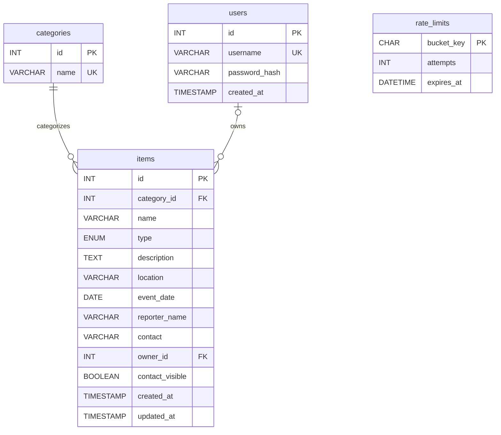

# University Lost and Found Portal

Small PHP application for the EC4307 30-mark mini-project rubric. Item reports support persistent Create, Read (including details/search/filter/sort), Update and confirmed Delete operations. Browsing is public; account ownership protects report management.

## Requirements and setup

- Existing XAMPP with Apache, PHP 8.1+ (PDO MySQL and mbstring), and MySQL/MariaDB.
- Keep this folder in `C:\xampp\htdocs\university-lost-and-found-portal`.
- Start Apache and MySQL using the XAMPP control panel.
- For a **fresh database**, import `database/schema.sql` with phpMyAdmin's Import tab or the MySQL client. It creates `university_lost_found`, seven tables and six categories. Reimporting this schema does not erase records, but does not upgrade an old installation.
- For an **existing pre-account database**, back it up privately, select its database, and import `database/migrations/001_report_ownership.sql` **once** instead. The migration adds users, rate limits and ownership/privacy columns without deleting reports. DDL auto-commits; if an import fails partway, inspect the existing tables/columns before retrying. Do not reset or recreate the database.
- Open <http://localhost/university-lost-and-found-portal/>.
- `config/database.php` uses the local XAMPP defaults (127.0.0.1:3306, root, empty password). Environment variables `DB_HOST`, `DB_PORT`, `DB_NAME`, `DB_USER`, `DB_PASSWORD` override them. Configure these in the Apache environment and restart Apache if needed. Use a dedicated database account for deployment; never commit credentials.

The application does not automatically load `.env`. It supports a private, Git-ignored `config/local.php` PHP array when the host cannot supply environment variables; `config/local.example.php` is the sanitized template. Environment database values take precedence over private values. With neither present, local XAMPP defaults remain unchanged. Keep tracked source free of private credentials. The SQL import requires permission to create the database and tables.

For InfinityFree, follow [the complete deployment guide](docs/infinityfree-deployment.md). Run `C:/xampp/php/php.exe deployment/build-infinityfree.php` to generate `build/infinityfree/htdocs` with exactly the runtime files and a non-secret production marker. Upload only that directory's contents to `/htdocs`; configure private credentials separately. The package omits tests, docs, SQL, exports, archives, logs and all private configuration. The host-specific, data-free SQL setup file is `deployment/infinityfree/schema.sql`, outside the upload folder. Do not import it into a nonempty database without reviewing the existing schema first.

Apache must honor the project's `.htaccess` files. In the directory configuration covering this project, `AllowOverride` must permit the `AuthConfig` and `Options` directive groups used by `Require all denied` and `Options -Indexes`. If overrides are disabled, the access protections will not apply. With Apache running, verify that requests to `config/database.php`, `includes/bootstrap.php`, `database/schema.sql`, and `tests/integration.php` return HTTP 403. Do not remove the access rules to resolve a setup error.

The website uses an original inline Lost & Found SVG mark and prominently identifies itself as an Independent Student Project. It does not use the university crest. The retired local crest file and assignment rubric remain excluded from Git; the crest is not referenced by pages or included in deployment builds. Obtain the rubric through the course’s authorized channel. The academic project title remains “University of Ruhuna Lost & Found Portal”; it is not a claim of official affiliation or endorsement.

Register an account at `register.php`, then sign in at `login.php` to create reports. Only that account can edit or delete its reports. Registration uses a unique username and password (at least 15 characters, at most 72 bytes). Accounts do not verify university enrollment. No default accounts, email verification, password recovery, or administrator web interface are provided; keep your credentials safe.

The migration was applied to the existing local database on 28 October 2026. Its four reports were preserved and remain publicly viewable but locked (`owner_id IS NULL`), with contact sharing disabled. Do not rerun the migration on this installation. A private pre-migration backup is in `database/backups/before-ownership-2026-10-28.sql`; it is ignored by Git and blocked by the database directory's access rules. Do not publish backups.

Legacy ownership must be assigned only by a trusted operator after independently verifying the creator and account. There is deliberately no public claim-by-name/contact feature. Assigning an owner must leave `contact_visible=0`; contact sharing has been replaced by private messaging. New reports receive their owner from the authenticated session, never a submitted owner field.

Reporter names and contacts are absent from ordinary public HTML. Contact disclosure is owner-only, even if a legacy sharing flag is enabled. Other users use the private inbox instead. Do not include personal contact information in public titles or descriptions. Messages are not end-to-end encrypted.

## Public-hosting configuration

- Use HTTPS and select production through `APP_ENV=production`, private PHP settings, or the generated production marker. The InfinityFree package forces production without environment variables. Production redirects safe HTTP requests to its fixed canonical HTTPS origin and rejects insecure POSTs before creating sessions. It suppresses displayed errors; actual host startup-level settings still need verification. If TLS terminates at a proxy, configure HTTPS indication at the trusted server/proxy layer; the app does not trust arbitrary forwarded headers or port numbers alone.
- Supply database settings through environment variables or the private PHP array. Production mode rejects incomplete credentials and the default administrative account. Use the least-privileged account the provider permits; dedicated-server installations should grant the application only SELECT/INSERT/UPDATE/DELETE and use a separate setup account for DDL. InfinityFree controls account privileges through its hosting panel.
- Keep session files, PHP logs and backups private, and verify Apache access rules (or equivalent rules on another server) before accepting traffic. Keep PHP/MariaDB patched and disable error display at the host configuration level too.
- Session cookies are HttpOnly, SameSite=Lax and Secure on HTTPS. Sign-in/sign-out regenerate the session ID; authenticated sessions expire after 30 minutes of inactivity or 12 hours total. Responses use `Cache-Control: no-store`.
- Persistent limits: registration 10 requests/hour per IP; login 60 requests/15 minutes per IP and 15 per username; report creation 30/hour per account; owner contact disclosure 20/hour per account; private message sending 30/hour per account. Excess requests return 429 with Retry-After. Expired buckets older than one day are cleaned during allowed requests. Behind a proxy, configure its trusted client-address handling correctly; the application uses REMOTE_ADDR.
- Review privacy/retention arrangements and the limits of open self-registration before public hosting. Rate limits reduce abuse but cannot prevent all spam or copying by account holders. The portal remains an independent student project.

## Structure

- `index.php`: browse/search/filter/sort.
- `item.php`: report details.
- `item-form.php`: create/edit with shared validation.
- `delete.php`: confirmation and POST-only deletion.
- `register.php`, `login.php`, `logout.php`: account creation, sign-in and CSRF-protected POST sign-out.
- `contact.php`: owner-only, CSRF-protected POST contact disclosure.
- `includes/`: PDO connection, validation, session/CSRF, escaping and shared templates.
- `config/`: environment-based connection settings.
- `assets/`: responsive CSS and progressive JavaScript validation/confirmation.
- `database/schema.sql`: non-destructive schema and category seed.
- `tests/integration.php`: CLI HTTP/database integration checks.
- `tests/schema.php`: isolated fresh-schema/migration compatibility checks.
- `tests/configuration.php`: production database configuration checks without a connection.
- `tests/deployment.php`: allowlist packaging and fail-closed production checks.
- `docs/`: official rubric and project design/testing notes.

## Database design

`categories` has a unique name and unsigned integer primary key. `items` has an unsigned integer primary key, a mandatory category foreign key, bounded text fields, a lost/found enum, a DATE for the event and timestamps for creation/update. Category removal is restricted while referenced. Both tables use InnoDB and utf8mb4. Event date and report type are indexed. Search is a literal substring match; user-provided sorting is mapped to a fixed allowlist.

`users` stores unique usernames and PHP password hashes, never plaintext passwords. `items.owner_id` is a nullable indexed foreign key with restricted user deletion; NULL represents locked legacy records. `items.contact_visible` defaults to 0. `rate_limits` stores hashed bucket identifiers, counters and expiry timestamps.



## Validation and safeguards

Description is optional (maximum 3000 characters); all other fields are required. Name: 120 characters; location/contact: 160; reporter: 100. Date must be valid, between 1900-01-01 and today in Asia/Colombo. Contact is free text to accept either email or phone; there is no delivery or contact verification. Browser constraints and JavaScript assist users; PHP validates independently. Prepared statements, output escaping, CSRF tokens, HttpOnly/SameSite cookies, a restrictive content security policy, and confirmation protect the shared workflow. Errors are logged server-side; database credentials and query details are not shown to visitors. Apache denies direct access to configuration, includes, SQL and tests.

## Tests

Run from the project folder with Apache and MariaDB running:

```powershell
Get-ChildItem -Recurse -Filter *.php | ForEach-Object { & C:/xampp/php/php.exe -l $_.FullName }
& C:/xampp/php/php.exe tests/integration.php
& C:/xampp/php/php.exe tests/schema.php
& C:/xampp/php/php.exe tests/configuration.php
& C:/xampp/php/php.exe tests/deployment.php
```

The integration suite uses HTTP requests through Apache and reads the actual MariaDB records independently. It creates uniquely named users/reports with separate cookie jars, checks account security, ownership, contact privacy, CRUD, optional descriptions, search/filter/sort, validation, CSRF, escaping and protected paths, then removes its own accounts/reports and account-specific test buckets. IP rate-limit counters remain in place: repeated runs may receive 429 until the window expires. Do not disable production limits to run tests. An optional first argument overrides the base URL.

Run these tests only on a local/development installation. The schema test needs CREATE/DROP DATABASE permission: it creates and removes only a randomly named `ulf_schema_test_*` database and compares it with the migrated application schema. It does not reset the application database. Configuration tests change only their own process environment and make no database connection.

See `docs/testing.md` for execution results and outstanding manual checks.

## Assessment deliverables still to prepare

The official PDF requires a GitHub link submitted through its Google Sheet, a report of at most 10 pages, and a camera-on demonstration of at most 5 minutes, due on or before 31 October 2026. Name submitted files with the student's index number. Include setup instructions, ERD and UI screenshots. Follow the institution's academic integrity and AI-assistance policy, and understand/explain the implementation. Git initialization/publication, final report and video are separate remaining submission work.

## Private messaging upgrade

Unread inbox badges require the separate additive migration `database/migrations/003_message_reads.sql` after migration 002. Existing messages are unchanged and initially unread for their recipients. See [unread notification setup and upload paths](docs/unread-messages.md). The current separate runtime package is `build/infinityfree-unread/htdocs/`.

Existing account-enabled installations must import `database/migrations/002_private_messages.sql` before using Inbox. It adds conversations and messages without changing existing reports or accounts. No application database was automatically migrated during implementation. See [private messaging setup, privacy and exact upload paths](docs/private-messaging.md) for the safe InfinityFree procedure. Never import a fresh-install schema over existing data.

Run `C:/xampp/php/php.exe tests/run-isolated.php` with XAMPP Apache/MariaDB running to test against a disposable local database without loading your real private configuration.
